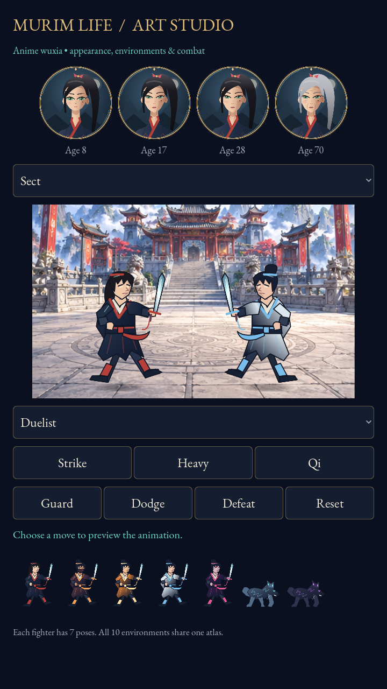

# Murim Life — Anime Wuxia Update

A Godot life simulator set in a martial arts fantasy world, with updated environments, character customization, fighter art and combat effects.

## Download and play in Godot

1. Click the green **Code** button above, then **Download ZIP**.
2. Extract the ZIP on your computer.
3. In Godot, click **Import** and select the `project.godot` in the extracted root folder.
4. Let asset imports finish, then press **F5** to run the game.

Use the root project, rather than the older copies in `dev/` or `verify/`.

Tested with **Godot 4.6.3**, Compatibility renderer. Android exports and device performance have not been tested.

## Preview the artwork and animation

Open **`art_gallery.tscn`** and press **F6**. Choose an environment and opponent, then try Strike, Heavy, Qi, Guard, Dodge, Defeat and Reset.

## Included improvements

- Ten anime-style environments.
- Appearance customization connected to New Life, gameplay portraits and saved games.
- Eight fighters with seven drawn poses each.
- Slash trails, hit sparks, Qi rings, recoil, heavy-hit shake and defeat animation.
- Refreshed navy, jade and gold interface colors and icons.

See [ART_UPDATE.md](ART_UPDATE.md) for the changes, editable asset locations, limitations and validation instructions. The rendered smoke test passed **170 checks**, and the packaged project passed a fresh import.

The original prototype folders, music and other legacy files are preserved. See existing asset files for their attribution and licensing requirements.
